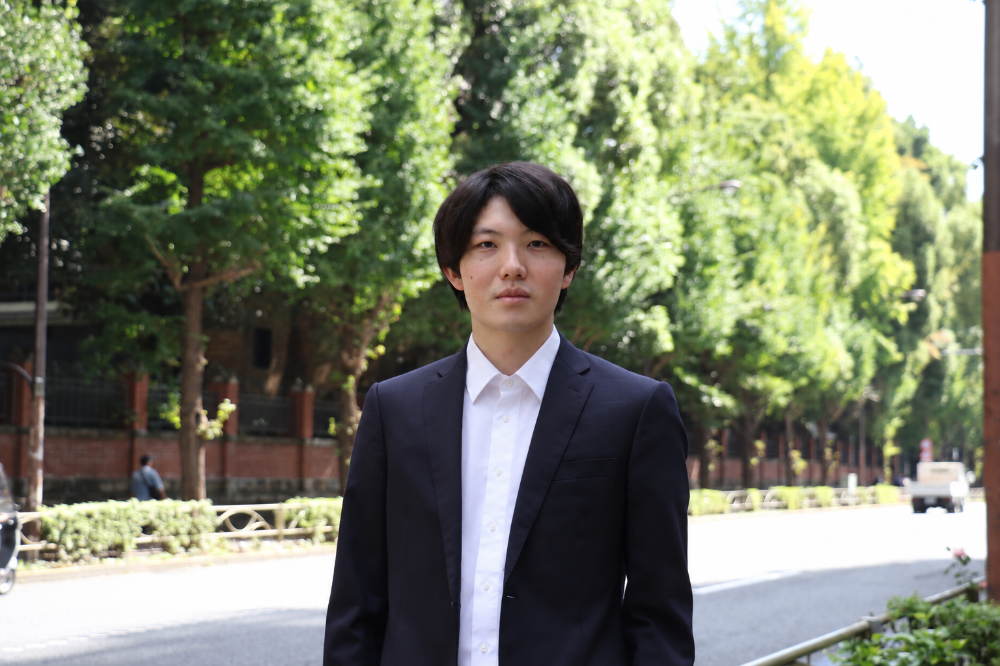

# 自己紹介（堀圭佑）

 

 

[DataPrism Technologies株式会社](https://dataprism.jp/) 代表取締役。

東京大学発のAIスタートアップとして、物流・製造・エネルギー・印刷・食品など業種を問わず、生成AI・AIエージェントを活用したシステムを企画から開発、運用まで一貫して手がけています。会社経営と並行して、株式会社松尾研究所でLLMの事後学習に関する研究開発プロジェクトにSub PMとして参画しています。

[[Facebook](https://www.facebook.com/profile.php?id=100093887304621)]

 

## 経歴

1998年生まれ、埼玉県出身。埼玉県立大宮高等学校、千葉大学工学部を経て、[東京大学大学院、医用精密工学研究室](http://www.bmpe.t.u-tokyo.ac.jp/)にて心臓の数値シミュレーションとAIを活用した心臓不整脈治療の最適化に関する研究に従事し、2023年修士号（工学）を取得。

2023年、AI x 金融スタートアップのトレーダム株式会社にて、時系列予測モデルや為替リスクヘッジアルゴリズムなどの開発に従事。

2024年6月、DataPrism Technologies株式会社を創業。同年8月より、株式会社松尾研究所にてLLMに関する研究開発プロジェクトのSub PMを務め、研究計画の策定および開発体制の管理を担い、モデル開発・分析にも携わる。

- Qiita技術ブログ [[KeisukeHori](https://qiita.com/Keisuke_Hori)]

 

## 職歴

- 2024 年 8 月 より: 株式会社松尾研究所 Sub PM（副業）
- 2024 年 6 月 より: [DataPrism Technologies株式会社](https://dataprism.jp/) 代表取締役
- 2023 年 4 月 - 2024 年 8 月: [トレーダム株式会社](https://tradom.jp/)　技術部門 データサイエンスチーム データサイエンティスト

 

## 学歴

- 2014 年 4 月 - 2017 年 3 月: 埼玉県立大宮高等学校 普通科 卒業
- 2017 年 4 月 - 2021 年 3 月: 千葉大学工学部 医工学コース 卒業
- 2021 年 4 月 - 2023 年 3 月: 東京大学大学院 工学系研究科 バイオエンジニアリング専攻 修士課程 修了

 

## 修士研究

 

頻脈性不整脈に対する効果的な焼灼治療戦略の検討に向けた

- 位相勾配の発散を用いた湧き出し興奮波の定量的検出手法の開発
- 深層学習を用いた疎な電極信号に基づく三次元膜電位分布推定手法の開発

について研究を行ってきました。

 

## 研究業績

 

### 学会発表

- 堀圭佑, 岩男悠真, 高橋美和子, 椎谷洋彦, 佐藤雅昭, 山谷泰賀: 肺移植後FDG-PET ～ Deep Learningによる拒絶反応予測と判断根拠の可視化 ～, 電子情報通信学会技術研究報告 信学技報, 3月, 2021.（口頭発表）

- 堀圭佑, 瀬野宏, 富井直輝, 山崎正俊, 佐久間一郎: 効果的なアブレーション治療に向けた細動中の湧き出し興奮波の定量的検出手法の開発, 日本生体医工学会関東支部　若手研究者発表会2021, 11月, 2021.（口頭発表）

 

### 代表論文

- Hori, K., Seno, H., Sakuma, I. et al. Phase Gradient Divergence for the Quantitative Detection of Focal Activation Events During Cardiac Fibrillation. J. Med. Biol. Eng. 43, 427–436 (2023). https://doi.org/10.1007/s40846-023-00804-0

 

### 受賞歴

- 優秀論文賞, Deeplearningを⽤いたFDG-PETによる肺移植拒絶反応予測とその判断根拠の可視化, 千葉大学工学部医工学コース, 2021年3月

 

### 特許

- Sakuma, I., Tomii, N., & Hori, K. (外国), Detection algorithm of breakthrough excitation among cardiac fibrillation (特許番号P211071US00), The University of Tokyo
